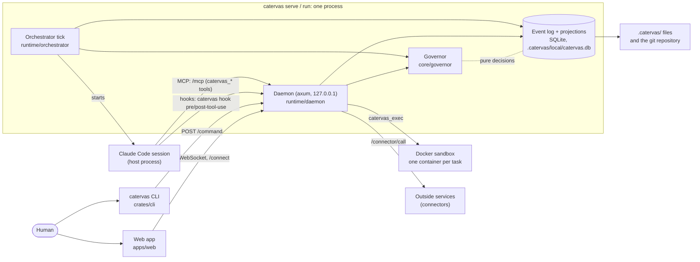

# How Catervas is put together

Catervas runs a team of AI agents against one git repository, with a deterministic governor between
every agent and every tool (`README.md`, `CLAUDE.md`). It is one Rust binary, `catervas`
(`crates/cli/Cargo.toml`), which also serves a React web app built from `apps/web` and embedded at
compile time (`crates/runtime/src/daemon/app.rs`, `#[folder = "../../apps/web/dist"]`).

Written from the code at commit `de0f2b8a` on `main`. Every fact names the file it was read in.

## The parts

| Part | What it is | Read in |
|---|---|---|
| `catervas` (crates/cli) | The command line and the process that drives a project: `catervas serve`, `run`, `plan`, and the human's commands. | `crates/cli/src/lib.rs` (`enum Commands`), `crates/cli/src/main.rs` |
| `catervas-core` (crates/core) | Schemas, the task state machine, the governor, budgets and the cost model. Performs no I/O, checked by `cargo xtask core-io`. | `crates/core/src/lib.rs`, `crates/core/Cargo.toml`, `xtask/src/main.rs` |
| `catervas-protocol` (crates/protocol) | The event envelope and kinds, the commands, the JSON-RPC wire to the browser, and the clock and id traits. | `crates/protocol/src/lib.rs` |
| `catervas-roles` (crates/roles) | Each shipped role as data (`role.yaml`, `system.md`, skills, `kit.yaml`), embedded in the binary. | `crates/roles/src/lib.rs`, `crates/roles/roles/*/` |
| `catervas-store` (crates/store) | The append-only event log in SQLite, the projections read from it (the board, costs, metrics), the files under `.catervas/`, and git. | `crates/store/src/lib.rs`, `crates/cli/src/project.rs` (`.catervas/local/catervas.db`) |
| `catervas-runtime` (crates/runtime) | The orchestrator that ticks the board, agent sessions behind one adapter trait (Claude Code, or recorded transcripts), the sandbox, the local daemon (hooks, MCP, browser), Catervas's own tools and connectors. | `crates/runtime/src/lib.rs` |
| `xtask` | The repository's own commands: `check`, `pre-commit`, `commit-msg`, `todos`, `core-io`, `install-hooks`. | `xtask/src/main.rs` |
| `@catervas/web` (apps/web) | The browser app: setup, Today, board, channel and chats, tasks, team, costs, events, settings. | `apps/web/package.json`, `apps/web/src/app/App.tsx` |
| `@catervas/protocol-client` (packages/protocol-client) | TypeScript types generated from `docs/schemas/{rpc,event,command}.schema.json`, and the client. | `packages/protocol-client/src/generate.ts` |
| `@catervas/ui`, `@catervas/brand` (packages/) | Shared React components; the brand's tokens, fonts and assets. | `packages/ui/package.json`, `packages/brand/package.json` |

The JSON Schemas in `docs/schemas/` are the one source of the wire and file types: the Rust crates
generate types from them at compile time with `typify` (`crates/core/src/lib.rs`, `generated`; ADR
`docs/decisions/0009-generate-schema-types-at-compile-time.md`), and the TypeScript client generates
its own from three of them.

## How the parts talk

- **Browser to daemon.** The daemon serves the embedded app at `/` and trades a one-time code at
  `POST /connect` for a session cookie; the app then talks JSON-RPC over `/rpc`, checked by `Origin`
  and `Host` (`crates/runtime/src/daemon/web.rs`, `crates/runtime/src/daemon.rs` `router_serving`).
  A subscription reads the log for new events every 500 ms (`web.rs`, `POLL`).
- **CLI to daemon.** A command given while another process drives the project goes to that
  process's daemon at `POST /command`, found through `.catervas/local/daemon.json`
  (`crates/cli/src/start.rs`, `DAEMON_FILE`; ADR `0014-commands-reach-a-running-farik-through-its-daemon.md`).
- **Sessions.** The orchestrator starts Claude Code as a host process (ADR
  `0004-agent-sessions-on-host-commands-in-sandbox.md`). Its settings route `PreToolUse` and
  `PostToolUse` hooks to `catervas hook pre-tool-use|post-tool-use`, which carries them to the daemon's
  `/hook/*` routes for allow or deny (`crates/runtime/src/claude.rs`, `crates/cli/src/hook.rs`).
  Catervas's own tools reach the agent over MCP at `/mcp` (`daemon.rs`, `CatervasMcp`).
- **Commands in the sandbox.** `catervas_exec` runs in a container per task from the image
  `catervas/sandbox:<version>`, or on the host in no-sandbox mode (`crates/runtime/src/sandbox.rs`,
  `sandbox/docker.rs`, `sandbox/host.rs`).
- **Connectors.** Kit and custom MCP servers are given per agent; Catervas's own servers (OSV, Google
  Ads, exchange rates, recalls, eBay) run as `catervas connector <name>` and call back through
  `/connector/call` with a ticket instead of the daemon token (`crates/cli/src/lib.rs`
  `ConnectorCommands`, `daemon.rs`).
- **Memory.** Every state change is an event appended to the SQLite log; the board and costs are
  projections of it; contracts, the team file, sprints and decisions are files under `.catervas/`
  (`crates/store/src/lib.rs`, `crates/store/src/files.rs`). `catervas doctor` reports where the two
  disagree (`crates/store/src/reconcile.rs`).

## How work moves

The orchestrator's tick reads the board and does the first thing that needs doing, running at most
one session to its end (`crates/runtime/src/orchestrator.rs`). Rules run in this order
(`crates/runtime/src/orchestrator/rules.rs`, `tick`): chats, sprint rules (end, review and retro,
planning, standup), 1 clean up accepted or cancelled tasks, 2 integrate accepted tasks, the budget,
channel and aged-escalation rules, data pipeline decisions, 3 `rejected`, 4 `blocked`, 5
`verifying`, 6 `in_progress`, 7 `assigned`, 8 `ready`, 9 `refining`, 10 `draft`. Every move between
statuses is asked of the governor, which answers from the store's facts and records a refusal as an
event (`crates/runtime/src/transitions.rs`, `crates/core/src/governor/transition_table.rs`).

Clock-driven work that starts no session is listed in `jobs.md`.

## Where to read more

- `docs/SPEC.md` is the specification; `CLAUDE.md` says its section 5 is the product.
- `docs/decisions/` holds the repository's ADRs: a template (0000) and 0001 to 0053, with no file
  numbered 0045, 0046 or 0051. `catervas_read_decisions` lists no decision recorded through Catervas
  yet.
- `structure.md` maps the directories; `features.md` lists what the project does; `jobs.md` lists
  scheduled and background work.
