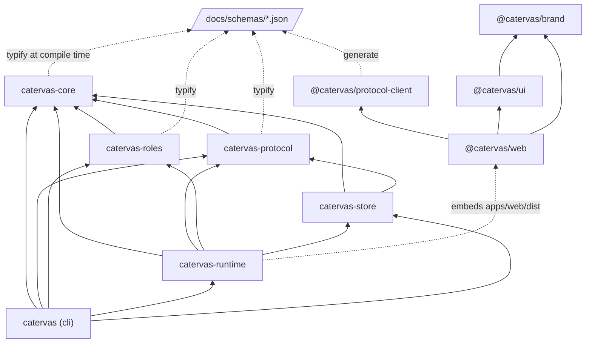

# How the repository is laid out

The directories, what each holds, and which way the dependencies run. Read at commit `de0f2b8a`.
There are two workspaces side by side: a Cargo workspace of seven packages (`Cargo.toml`,
`members = ["crates/*", "xtask"]`) and a pnpm workspace of four (`pnpm-workspace.yaml`,
`packages/*` and `apps/*`).

## Top level

| Path | What it holds |
|---|---|
| `crates/` | The six Rust crates of the product (below). |
| `xtask/` | `cargo xtask`, aliased in `.cargo/config.toml`: the full check, git hooks, the TODO and core-I/O checks (`xtask/src/main.rs`). |
| `apps/web/` | The browser app, `@catervas/web`: React 19, React Router, Vite; unit tests with Vitest, the browser journey with Playwright in `apps/web/e2e/` (`apps/web/package.json`). |
| `packages/` | `protocol-client` (generated wire types and the client), `ui` (shared components and a gallery), `brand` (tokens in `tokens/tokens.json`, fonts, assets). |
| `docs/` | `SPEC.md`, `PRODUCT_ANALYSIS.md`, `schemas/` (the JSON Schemas every wire and file type comes from), `decisions/` (the repository's ADRs), `plans/` (`project-plan.md`, one folder per phase, `standalone/`, `step-template.md`), `standards/` (`code.md`, `workflow.md`), `design/` (designs and `mockups/`), `brand/`. `docs/catervas/` is the team's folders; this file is in its `architecture/`. |
| `.github/` | The one workflow, `workflows/check.yml`, and `pull_request_template.md`. |
| Root files | `Cargo.toml`, `Cargo.lock`, `rust-toolchain.toml`, `rustfmt.toml`; `package.json`, `pnpm-lock.yaml`, `biome.json`, `tsconfig.base.json`, `.node-version`; `CLAUDE.md`, `CONTRIBUTING.md`, `README.md`, `LICENSE`. |

## The Rust crates

| Crate | Path | Holds |
|---|---|---|
| `catervas-core` | `crates/core/src/` | `contract`, `criteria`, `team`, `sprint` and their validators; `governor/` (transition and its table, readiness, gates, permissions, paths, sites, escalation, done, team rules); `budget`, `pricing/`, `marketing`, `order`, `pipeline`, `renewals`, `branch`, `skill`, `text`; `generated/` from `docs/schemas/`. No I/O. |
| `catervas-protocol` | `crates/protocol/src/` | `event` (envelope, kinds, wire form), `command`, `rpc`, `clock`, `generated/`. |
| `catervas-roles` | `crates/roles/` | `src/`: the loader, kits, connectors, reviewer, approved sites, skill check. `roles/<role>/`: `role.yaml`, `system.md`, `kit.yaml`, `skills/<name>/SKILL.md` for eight roles. |
| `catervas-store` | `crates/store/src/` | `event_log`, `migrations`, `projections`, `files` (the `.catervas/` files), `git`, `diff`, `baseline`, `scan`, `reconcile`, `metrics`, `waiting`, `requests`, and the log's readings for marketing, pipelines, purchase orders, renewals, seller mail and sites. |
| `catervas-runtime` | `crates/runtime/src/` | `orchestrator/` (the tick and its rules, sessions, verify, integrate, human commands, recover, design, pipeline, hand-over, spend); `daemon/` (the axum service: hooks, MCP, web, app, gates, board, team, setup, templates, sign-ins, connector calls); `tools/` (each `catervas_*` tool); `session`, `claude`, `recorded`, `stream`, `prompt`; `sandbox/`, `preview/`; connectors and services (`connectors`, `sign_in`, `registered_apps`, `osv`, `fx`, `google_ads`, `recalls`, `ebay`, `mailbox`, `procurement/`, `marketing/`). `build.rs` rebuilds it when `apps/web/dist` changes. |
| `catervas` | `crates/cli/src/` | `main.rs` (the binary), `lib.rs` (the commands, `run_cli`), one module per command family, `bin/catervas-e2e-serve.rs` (feature `e2e` only). |

Tests: each crate's unit tests sit in its modules (with `fixtures.rs` beside some); integration tests
in `crates/cli/tests/`, `crates/runtime/tests/`, `crates/store/tests/`. Tests that need git, Docker or a
program are `#[ignore]` and run under `cargo xtask check --integration` (`.github/workflows/check.yml`
comment, `xtask/src/check.rs` `test_arguments`).

## Which way the dependencies run

From each `Cargo.toml` and `package.json`:

- `catervas-core` depends on no other crate of the workspace; `xtask` depends on none either
  (`crates/core/Cargo.toml`, `xtask/Cargo.toml`).
- `catervas-roles` does not depend on `catervas-store`, so it keeps its own copy of the YAML options
  (`crates/roles/src/lib.rs`, `yaml_options`).
- The Rust side reaches the web app only through `rust-embed` of the built `apps/web/dist`
  (`crates/runtime/src/daemon/app.rs`); the web app reaches Rust only through the wire types the
  schemas define.

## What Catervas writes into a project it runs

Read from `crates/store/src/files.rs`, `crates/cli/src/project.rs`, `crates/cli/src/start.rs` and
`crates/runtime/src/orchestrator.rs`; this repository's worktree holds no `.catervas/` of its own.

| Path | What it holds | Ignored by git |
|---|---|---|
| `.catervas/team.yaml` | The team: agents, roles, rules | no |
| `.catervas/team/criteria.yaml`, `.catervas/team/retro.md` | The criterion library; the retros | no |
| `.catervas/contracts/`, `.catervas/sprints/`, `.catervas/decisions/` | Contracts, sprints, decisions | no |
| `.catervas/project.md`, `.catervas/prices.json` | The project scan; the price table | no |
| `.catervas/local/` | Ignored by its own `.gitignore` (`*`) and by this repository's `.gitignore` | yes |
| `.catervas/local/catervas.db` | The event log and projections (SQLite) | yes |
| `.catervas/local/worktrees/CTV-<n>` | A task's worktree on its branch | yes |
| `.catervas/local/finance`, `.catervas/local/procurement` | The Finance and Procurement Specialists' private folders | yes |
| `.catervas/local/daemon.json`, `settings.json`, `channel-summary.md` | How to reach the driving process; local settings; the channel's summary | yes |
